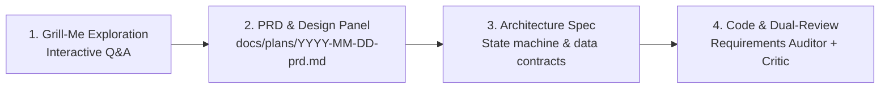

# PRD: AI-Native Engineering Architecture & CTO Guardrails
**Document ID:** `docs/plans/2026-10-22-ai-native-architecture-guardrails.md`  
**Status:** Approved & Frozen  
**Author:** Antigravity (Principal Systems Architect)  
**Stakeholder:** Faizan Ahmed (CTO, Speisely)  

---

## 1. Problem Statement & Context
Prior to October 2026, feature development on Speisely Marketplace often relied on single-prompt "vibe coding". While rapid, this approach created technical debt, including:
1. Missing architectural specifications, leading to edge-case bugs in complex features (Stripe webhooks, caterer availability, multi-role auth).
2. Stylistic divergence across UI components due to the absence of a strict design token contract (`docs/DESIGN.md`).
3. Single-agent context fatigue, where one model tried to manage SQL migrations, React state, Tailwind styling, and accessibility simultaneously.

---

## 2. Goals & Acceptance Criteria
* **G1:** Establish a permanent, version-controlled specification repository in `docs/plans/` and `docs/plans/disciplines/`.
* **G2:** Codify Speisely's **Luxury Editorial Gastronomy** design system tokens into `docs/DESIGN.md`.
* **G3:** Integrate the **Elephant & Goldfish Model (EGM)** into `.agents/AGENTS.md`, enforcing an interactive interview gate (`/grill-me`), mandatory `ask_question` UI modals, and an adversarial "Mean Staff Critic" for high-risk database/payment changes.
* **G4:** Prevent agent test cheating by making existing validation schemas and test suites strictly immutable.

---

## 3. The 4-Step Product Development Lifecycle

1. **Exploration Gate (`/grill-me`):** Agents must interrogate requirements using the `ask_question` tool with a `(Recommended)` option before touching code.
2. **Subagent Specialization:** Parallel subagents (`ux-designer`, `accessibility-specialist`, `database-security`) draft isolated specs to `docs/plans/disciplines/`.
3. **Finite State Machines:** All interactive components (modals, reservation flows, checkouts) must explicitly define their states (`IDLE -> IN_PROGRESS -> EVALUATING -> SUCCESS / ERROR`).
4. **Adversarial Review:** High-risk PRs must be audited by an independent Flash subagent checking for concurrency bugs and Supabase WAL bloat.

---

## 4. Non-Functional Constraints
* **Platform Standards:** Zero unnecessary npm packages. Prefer native HTML `<dialog>`, CSS container queries, and native fetch.
* **Accessibility:** Strict WCAG 2.1 AA/AAA color contrast ratios (minimum 4.5:1 for body, 3:1 for large display text).
* **Database Safety:** 100% RLS coverage, no unbounded `pg_cron` jobs, read-only public catalog queries with 60s in-memory SWR caching.
